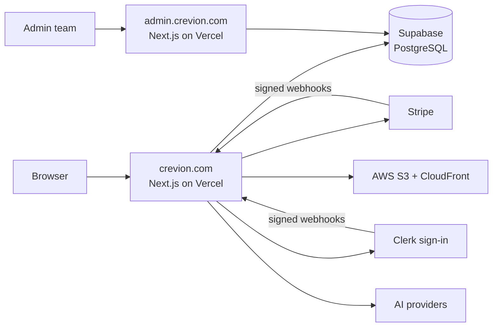

# Crevion

**Live at [crevion.com](https://www.crevion.com)** · Built by [Harshil Patel](https://www.linkedin.com/in/harshil8201/) · February 2026 to now

Crevion turns one sentence into a finished, editable marketing poster for a small business. The owner types what they are promoting, the AI writes the copy, picks a layout and a photo, and returns three styled options. The owner then finishes the design in a full browser editor and downloads it.

> The source code is private. This repository describes what I built and how it fits together.

## At a glance

| | |
| --- | --- |
| Apps in production | 3 (customer app, creator marketplace portal, admin panel) |
| Code | About 144,000 lines of TypeScript |
| API endpoints | 172 |
| Database | 57 PostgreSQL tables, 60 numbered migrations |
| Tests | 29 Jest test suites for server routes, plus Playwright browser tests |

## What it does

- **AI poster generation.** A one-sentence prompt becomes three editable poster layouts (Minimal, Bold and Luxury), written in parallel.
- **Design editor.** A full in-browser editor on Fabric.js: text, shapes, photos, brand colours and fonts, layers, effects, undo history, autosave, and PNG, JPG and PDF export.
- **Creator marketplace.** Independent designers sell templates, fonts and design objects, with a review flow, ratings, analytics and weekly payouts.
- **Admin panel.** Revenue, payouts, refunds, creator and template approval, AI model selection and service health checks.
- **Billing.** Pro subscriptions, credit packs and marketplace purchases through Stripe.

## Architecture

- **The server owns the rules.** Browsers only talk to Crevion's own pages and endpoints. The endpoints talk to the database, payments, storage and AI.
- **Webhooks** from Stripe and Clerk are signature-verified and processed exactly once.
- **Scheduled jobs** on Vercel Cron run creator payouts, monthly reports, onboarding emails and data refreshes.

## AI pipeline

1. The prompt is parsed to understand the business, the offer and the tone.
2. A language model writes each layout in a structured layout schema (not an image), so every element stays an editable layer with exact text.
3. Each layout is validated against the schema and repaired where possible (colour formats, positions, missing fills). A failed layout is retried once.
4. If a request still fails, the owner gets a ready-made template instead of an error, and the team is alerted.
5. Every generation is logged and can be rated, which builds training data.

Supporting work in **Python**: a converter from Fabric.js templates into the layout schema, data cleaning and validation for layout JSON, training data preparation for fine-tuning an open-source model (Qwen 3.5 9B) on Crevion's own layouts, and a scoring algorithm that ranks generated layouts.

## Tech stack

| Layer | Technology |
| --- | --- |
| Web | Next.js 16 (App Router), React 19, TypeScript |
| Styling | Tailwind CSS with shared design tokens (light and dark themes) |
| Editor | Fabric.js, Zustand |
| Data | Supabase (PostgreSQL), Upstash Redis, Pinecone |
| Auth and payments | Clerk, Stripe |
| Files | AWS S3 with CloudFront |
| AI | Together AI, Google Gemini, Anthropic Claude, OpenAI |
| Ops | Vercel (previews and cron), Sentry, Resend |
| Testing | Jest, Playwright |

## Security

- No browser ever talks to the database directly; public database roles can read nothing.
- Every route that touches a design, template or payout checks that the record belongs to the signed-in person.
- Rate limits protect AI and payment endpoints.
- Uploads accept only PNG, JPEG and WebP.
- A security review in October 2026 found and closed seven issues.

## How it ships

Every push builds a preview on Vercel. Tests, a production build and a type check must pass. Database changes are numbered migrations tested on a development database before being applied to production. Merging to main deploys production.
